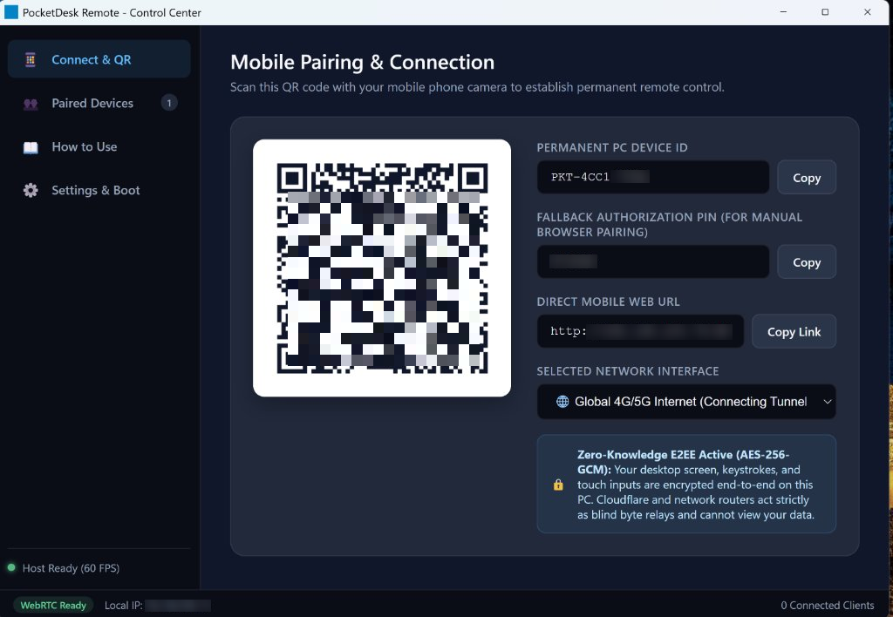
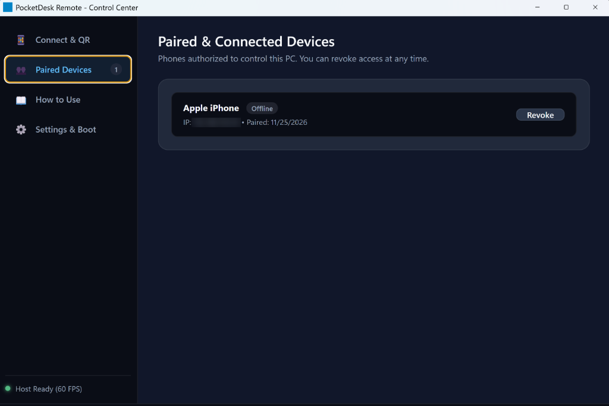
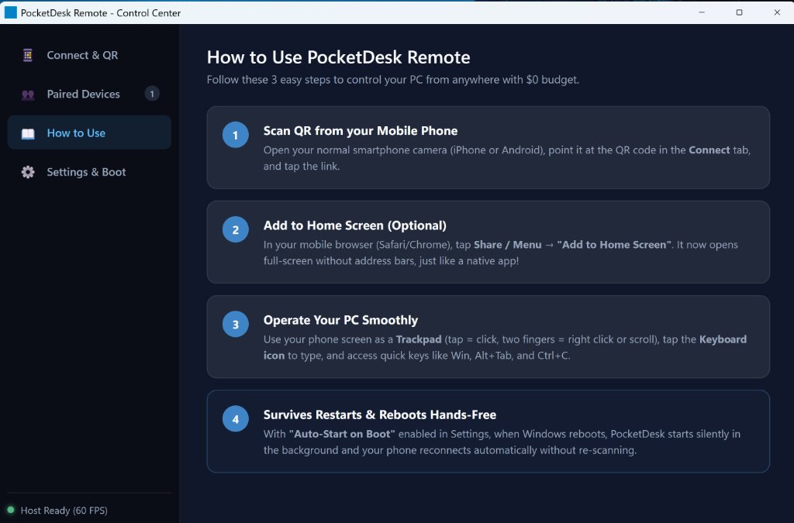
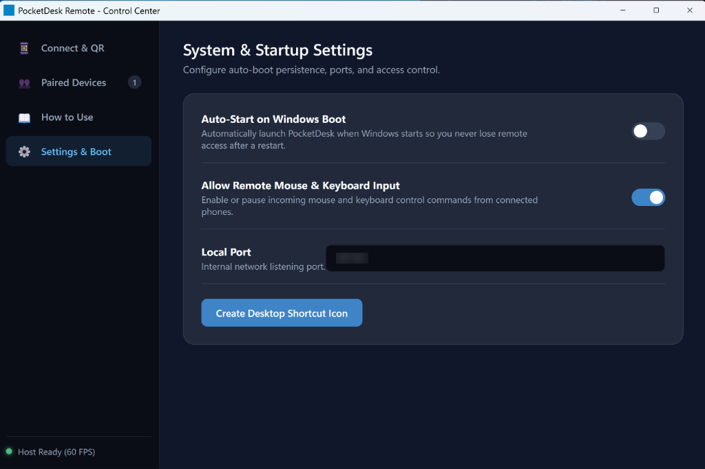

<div align="center">

# 👻 GHOST Remote — Open-Source Mobile-to-PC Remote Desktop
### *Zero-Budget QR-Paired Remote Control, 60 FPS WebRTC Desktop Streaming & Windows Hardware Input Injection*

[](https://www.electronjs.org/)
[](https://nodejs.org/)
[](https://webrtc.org/)
[](./input_injector.cs)
[](./package.json)

<br />

<p align="center">
  <b>GHOST Remote</b> is an open-source, private alternative to commercial remote desktop software like TeamViewer and AnyDesk. Featuring instant one-scan QR mobile pairing, direct LAN / Cloudflare tunneling, real-time 60 FPS WebRTC screen sharing, and native C# Win32 hardware input simulation, GHOST turns any smartphone browser into a wireless trackpad, keyboard, and control monitor with zero subscription fees.
</p>

</div>

<br />

<p align="center">
  
</p>

---

## 📖 Overview

GHOST Remote establishes a direct peer-to-peer or tunneled connection between your desktop and a smartphone. Pairing is handled through a one-time dynamic QR code containing unique session credentials. Once connected, your phone functions as a wireless trackpad, keyboard, and display monitor with ultra-low latency.

---

## Visual Walkthrough

| 📱 Mobile QR Pairing | 👥 Authorized Device Manager |
| :---: | :---: |
|  |  |
| **Instant one-scan connection** | **Monitor and revoke active devices** |

| 📖 Step-by-Step Instructions | ⚙️ Startup & Access Settings |
| :---: | :---: |
|  |  |
| **Clear guide for mobile web pairing** | **Auto-start persistence and input permissions** |

---

## Key Features

- **Instant QR Pairing**: Scan a generated QR code from your mobile browser without installing a native phone app.
- **Real-Time Display Streaming**: Captures the Windows desktop and streams video via WebRTC at high frame rates.
- **Hardware-Level Input Injection**: Uses a lightweight C# helper to simulate smooth mouse movements, clicks, and keystrokes directly in Windows.
- **Cloudflare Quick Tunnel Integration**: Enables access across different networks without manual router port-forwarding.
- **Minimal Footprint**: Built with Electron and vanilla web technologies for fast loading and low CPU overhead.
- **Device Management**: View and revoke connected mobile clients from the desktop control panel.

---

## System Architecture

```text
+-----------------------+                    +-----------------------+
|  Mobile Web Client    |                    |  Desktop Host (GHOST) |
|  - Virtual Trackpad   | <--- WebRTC Data - |  - Electron Dashboard |
|  - Keyboard Input     | ---- Input Events->|  - WebSocket Server   |
|  - Low-Latency Video  |                    |  - C# Input Injector  |
+-----------------------+                    +-----------------------+
            ^                                            ^
            |                                            |
            +------------- Secure Tunnel / LAN ----------+
```

---

## Project Structure

```text
ghost/
├── assets/                  # Icons and visual branding assets
├── desktop/                 # Electron dashboard HTML, CSS, and renderer scripts
│   ├── index.html           # Main host user interface
│   ├── renderer.js          # Desktop UI logic and device pairing state
│   └── style.css            # Dark-themed control panel styling
├── docs/                    # Architectural diagrams and showcase screenshots
│   └── screenshots/         # High-resolution application previews
├── public/                  # Mobile progressive web app
│   └── mobile/              # Client web app served to connected phones
├── inputManager.js          # Bridges WebSocket input commands to the injector
├── input_injector.cs        # Win32 SendInput source code for hardware injection
├── input_injector.exe       # Compiled input simulation executable
├── tunnelManager.js         # Cloudflare tunnel process manager
├── cryptoManager.js         # Session token generation and encryption helpers
├── server.js                # Express HTTP and WebSocket communication server
├── main.js                  # Electron application entry point
├── package.json             # Node.js dependencies and scripts
└── start-pocketdesk.bat     # Windows launcher script
```

---

## Getting Started

### Prerequisites

- Node.js (version 18 or newer)
- Windows 10 or Windows 11

### Installation

1. Clone the repository:
   ```bash
   git clone https://github.com/Ahmad-Haassan/ghost.git
   cd ghost
   ```

2. Install dependencies:
   ```bash
   npm install
   ```

3. Launch the application:
   ```bash
   npm start
   ```
   Or double-click `run.bat`.

### Connecting from Mobile

1. Launch GHOST Remote on your computer.
2. Ensure both devices are on the same local network, or enable the online tunnel in settings.
3. Open the camera on your phone and scan the QR code shown on the desktop screen.
4. Use the on-screen touchpad and keyboard to control your PC remotely.

---

## Author

**Ahmad Hassan**  
GitHub: [@Ahmad-Haassan](https://github.com/Ahmad-Haassan)
